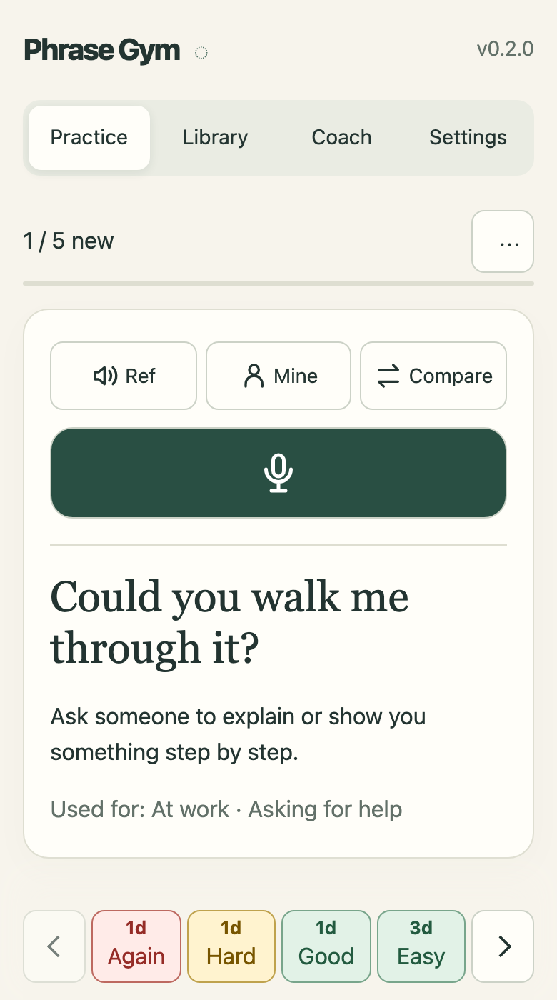

# Phrase Gym

**Make the English you hear part of the English you speak.**

Bring in phrases from a lesson, a video, or a conversation. Get a situation, try saying the phrase
from memory, then hear how it sounds alongside your own take.

<table>
<tr>
<td align="center" valign="top"><b>Say it from a situation</b> </td>
<td align="center" valign="top"><b>Reveal, compare, and rate</b> </td>
</tr>
</table>

- **Practise your own material.** Give Coach a phrase or word and it builds a card with
  context, hints, and reference audio. An AI agent can bring in a whole lesson at once.
- **Hear the difference.** Record a take, play the reference and your voice back to back,
  and revisit saved recordings in your Library.
- **Come back when it’s due.** Rate your recall to schedule the next review. Do a short daily
  session, get extra practice when you want it, or pick a phrase to rehearse.

[Install Phrase Gym](https://andgineer.github.io/phrase-gym/installation/) ·
[User guide](https://andgineer.github.io/phrase-gym/) ·
[Add your phrases](https://andgineer.github.io/phrase-gym/importing-phrases/) ·
[Use it on your phone](https://andgineer.github.io/phrase-gym/private-access/)

## Under the hood

I built Phrase Gym to make the expressions from my lessons come to mind in conversation.

- **Keep the take, even if I move on.** Vue journals the recording and its cue in IndexedDB before
  advancing. A stable take ID lets the browser retry the upload without duplicating the recording.
  [Recording design](specs/decision-recording-and-comparison.md)
- **Give AI the phrase and keep practice independent.** A small Python server serves Vue and stores
  the work in SQLite. A separate Coach uses my logged-in model CLI and local Piper voice, then
  publishes the complete card through the API. Requests survive restarts, and each card arrives
  with its audio in one publication.
  [Architecture](specs/architecture.md)
- **Show what a rating will do.** The card previews all four FSRS return intervals. The server
  commits the rating, next due date, and practice history together.
  [Scheduling design](specs/decision-core-trainer.md)

<b>Collaborating</b>

Start with the [design decisions and remaining work](specs/START-HERE.md),
[development and releases](specs/development.md), and [agent instructions](AGENTS.md).
See the [Allure test report](https://andgineer.github.io/phrase-gym/builds/tests/) for CI results.

