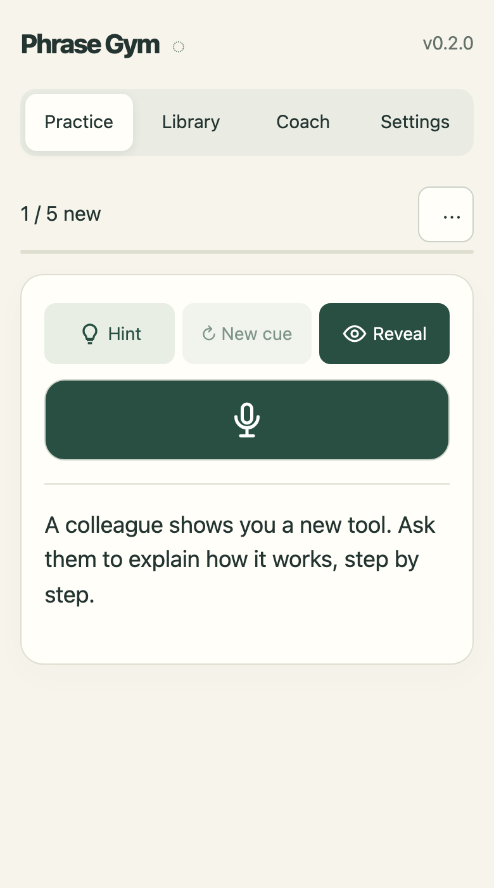

# Phrase Gym

[](https://github.com/andgineer/phrase-gym/actions)
[](https://htmlpreview.github.io/?https://github.com/andgineer/phrase-gym/blob/python-coverage-comment-action-data/htmlcov/index.html)

**Make the English you hear part of the English you speak.**

Bring in phrases from a lesson, a video, or a conversation. Get a situation, try saying the phrase
from memory, then hear how it sounds alongside your own take.

<table>
<tr>
<td align="center" valign="top"><b>Say it from a situation</b><br></td>
<td align="center" valign="top"><b>Reveal, compare, and rate</b><br></td>
</tr>
</table>

- **Practise your own material.** Give Coach a phrase or word and it builds a card with
  context, hints, and reference audio. An AI agent can bring in a whole lesson at once.
- **Hear the difference.** Record a take, play the reference and your voice back to back,
  and revisit saved recordings in your Library.
- **Come back when it’s due.** Rate your recall to schedule the next review. Do a short daily
  session, get extra practice when you want it, or pick a phrase to rehearse.

[Install Phrase Gym](https://andgineer.github.io/phrase-gym/installation/) ·
[User guide](https://andgineer.github.io/phrase-gym/) ·
[Add your phrases](https://andgineer.github.io/phrase-gym/importing-phrases/) ·
[Use it on your phone](https://andgineer.github.io/phrase-gym/private-access/)

## Built on second-language learning research

Before designing Phrase Gym, I reviewed studies on how people learn, recall, and use expressions
in a second language. I documented what each study tested, where its findings applied, and which
design choices the evidence could support. That work shaped the core practice loop, down to what
a card shows and when it offers help.

- **Bring the same phrase back in different situations.** In vocabulary experiments, changing
  the practice sentences improved recall, even though learners expected repeating them to work
  better. In Phrase Gym, “So far, so good” can be an answer about a report or a group ride.
  [Variable retrieval study](https://pmc.ncbi.nlm.nih.gov/articles/PMC11536137/)
- **Say the reply before hearing it.** In a study of second-language requests, accuracy gains
  carried across listening and speaking tasks, while speed gains stayed with the task learners
  had practised. That’s why speaking is part of the recall step itself.
  [Listening and speaking study](https://doi.org/10.1111/modl.12123)
- **Give the meaning and leave the wording to recall.** In a study of word combinations, filling
  a gap after studying the phrase gave the best delayed results among the formats tested. I
  adapted that for speech with a meaning in parentheses and an optional hint like “far / good.”
  [Gap-fill study](https://doi.org/10.1111/modl.70007)

[Research notes and the decisions they informed](specs/research/README.md)

## Under the hood

- **Keeping browser audio tied to the right card.** Closing the microphone after each take on
  desktop Safari interrupted Bluetooth playback. On iPhone, the app releases the input before
  comparison. I built the recorder around those differences and journal each take in IndexedDB
  before advancing. A stable take ID keeps upload retries tied to the original phrase and
  prevents duplicate recordings.
  [Recording design](specs/decision-recording-and-comparison.md)
- **Making AI card quality testable.** A model can return valid JSON and still teach the wrong
  sense or give away the answer. I use the same card rules across model CLIs, check structure
  in code, and review actual model outputs in separate sessions. Coach uses a durable SQLite
  handoff, so the practice app stays usable while the model and local Piper voice prepare audio.
  [Preparation and evaluation](specs/decision-external-preparation-agent.md)
- **Keeping the database layer small by measuring it.** I prototyped SQLAlchemy against the
  real review and search paths. The first version let concurrent writes overwrite each other,
  and the rating save grew from two statements to four. I kept explicit SQLite transactions
  and used typed rows checked against the database schema.
  [Database comparison](specs/architecture.md#database-access)

<details>
<summary><b>Contributing</b></summary>

Use Python 3.13, uv, and Node 22.12+ on an LTS release.

```bash
uv sync --frozen
npm --prefix frontend ci
(cd frontend && npx playwright install chromium webkit)
uv run pre-commit install

uv run inv run --build  # Start the app at http://127.0.0.1:8000
uv run inv pre          # Run static checks
uv run inv test         # Run Python, Vue, Chromium, and WebKit checks on macOS
```

[Development and releases](specs/development.md) ·
[Architecture](specs/architecture.md) ·
[Remaining work](specs/plan/implementation-plan.md) ·
[Allure test report](https://andgineer.github.io/phrase-gym/builds/tests/)

</details>
