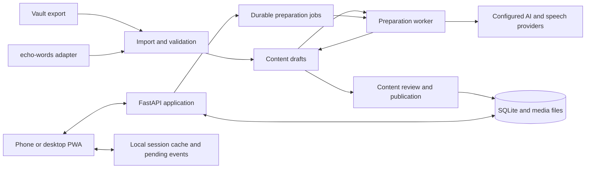

# Phrase Gym — proposed architecture

2026-10-11. Architecture recommendation and implementation design, not a claim that the app or its prototypes exist. The agreed product baseline is [targeted drilling](decision-targeted-drilling.md) and [optional recording/comparison](decision-recording-and-comparison.md). The name is Phrase Gym. Earlier interface sketches and legacy tooling are not accepted implementations. Start with the [prototyping plan](plan/01-prototyping.md); implementation follows the [roadmap](plan/implementation-plan.md).

## Recommendation

Build a personal, mobile-first web app that can be installed as a PWA. Use **Vue 3 + TypeScript** for the interface, **FastAPI + Python** for the API and preparation jobs, and **SQLite + a local media directory** for durable storage. Keep it one application with clear internal modules. Prepare learning material before sessions; the core drill must work without an AI request.

These choices are proposed engineering defaults. The browser/audio prototype must demonstrate that they fit the actual phone before they become the production foundation. Hosting and the visual layout remain open.

| Option | What the user gets | Main trade-off |
|---|---|---|
| **PWA with a small Python backend — recommended** | One app on phone and desktop, durable content and progress, prepared sessions that can later work offline. | Real-device audio, interruption and storage behaviour need validation. |
| Native iOS app with the same backend | A platform-specific interface and access to native audio facilities. | A separate client and distribution workflow; consider if the PWA fails a required audio capability. |
| Browser-only app | Easy initial distribution and entirely local practice. | Durable cross-device progress, recovery and server-side material preparation become separate problems. |

Vue and FastAPI align with the nearby echo-words codebase without requiring Phrase Gym to share its runtime or database. This is a maintenance judgment, not evidence that another stack could not work.

## System shape



A normal session reads published content and writes practice events. Provider outages can delay new material but cannot interrupt an already prepared drill.

## Components and ownership

| Component | Responsibility | Does not own |
|---|---|---|
| Content domain | Target identities, meanings, realizations, immutable revisions, cues, dialogues and provenance. | Learner progress. |
| Session planner | Choose due/new targets and approved cue variants; prepare an immutable session manifest. | Speech grading or generation during a turn. |
| Browser session engine | Present the current step, play media, manage help/recording, pause/resume and journal events. | The authoritative review schedule. |
| Practice service | Validate attempts, deduplicate retries, classify support and commit history. | A claim that a self-report or transcript proves fluent use. |
| Review policy | Maintain one schedule per learner and target from eligible observations. | One schedule per mask, dialogue appearance or source. |
| Media service | Store and serve model audio and saved takes; expose verified metadata and retention controls. | Content identity or automatic pronunciation scores. |
| Preparation worker | Import normalization, candidate generation, cue checks and speech synthesis. | Direct publication of unchecked model output. |
| Source adapters | Translate vault or echo-words material into the import contract. | Direct writes into learning or scheduling tables. |

See [learning behaviour](architecture/learning-engine.md) and [data/API contracts](architecture/data-contracts.md) for the boundaries that must remain stable through UI changes.

## Application stack and layout

- **Client:** Vue 3, TypeScript, Vite and Vue Router. A pure TypeScript session reducer handles transitions; views render its state. Keep fetch, recording and persistence behind small adapters. Use IndexedDB for session checkpoints and pending events; Cache Storage for downloaded immutable media. Add a service worker when the prepared-session offline milestone is built.
- **Server:** FastAPI, Pydantic request/response models, SQLAlchemy and Alembic migrations. Generate TypeScript API types from the OpenAPI contract. Use short database transactions; keep network calls and media processing outside them.
- **Runtime:** one API process serving the built client and API from the same origin, plus one bounded worker from the same Python package. A SQLite jobs table provides durable work, leases and retry state. No Redis or distributed job system is needed for the proposed personal workload.
- **Storage:** one local SQLite database with foreign keys, WAL mode and a busy timeout; immutable model media addressed by hash; private recording files linked to attempts. Use a local filesystem for SQLite, not a network-mounted database file.
- **Tooling:** Python environment/lockfile through uv, npm lockfile, Python lint/type checks and pytest, TypeScript checking and Vitest, browser flow tests with Playwright. Pin a tested dependency set during foundation work; this plan does not prescribe unverified latest versions.

```text
specs/                         agreed decisions and current plans
prototypes/drill-flow/         disposable interaction prototype, to be created
prototypes/audio-probe/        real-device capability probe, to be created
webapp/src/
  features/{practice,library,dialogues,content}/
  session/                    pure state machine and local journal
  platform/                   media, IndexedDB, network adapters
src/phrase_gym/
  api/                        HTTP contracts and authentication boundary
  content/                    targets, cues, revisions and imports
  practice/                   sessions, attempts and review policy
  media/                      storage and audio preparation
  jobs/                       worker, provider interfaces and retries
  adapters/                   vault and echo-words intake
migrations/
fixtures/                     reviewed learning content and edge cases
tests/{unit,integration,browser}/
```

The user-created scaffold in `~/projects/phrase-gym` is the actual starting point: preserve `src/phrase_gym`, hatchling/uv, the rich-click entry point, pytest, Invoke, documentation and CI conventions. Production modules and a client remain future work. All development docs belong under `specs/` (plural). The old trainer is outside the new app boundary; a [source-format reference](reference/legacy-tooling.md) and archive preserve the relevant context here. No earlier code or stopped prototype establishes a completed milestone.

## Content and AI

A target represents a particular expression or word sense/construction. Its examples, cue masks and dialogue turns reference that identity. Preserve source references without allowing a source re-import to reset progress. A change in meaning creates a new target; an editorial correction creates a new content revision.

Preparation proceeds through **draft → structural checks → linguistic/cue review → published**. Initial content is hand-reviewed. AI can propose situations, phrase chunks, competing completions, cue variants, dialogues and explanations. A second AI check is useful evidence but cannot certify naturalness or uniqueness. Keep prompts, model identity and generation provenance with each draft.

Use a provider interface, with llmbroker and existing speech tools as candidates after capability and cost checks. Do not import echo-words' application internals or paid-provider settings wholesale. Start with explicit limits, cached results and no automatic paid escalation. Learner voice recordings are not sent to an AI provider by the core flow.

## State, connectivity and recovery

The server owns published content, committed attempts and schedules. The browser owns an unacknowledged local journal until the server confirms receipt. Save a turn's support/exposure history before showing its next state; reopening the page must not turn a model-assisted attempt into a fresh recall success.

Build an online session first. Add **offline completion of an explicitly downloaded session** later: cache its manifest, approved alternate cues and required model audio, then verify the pack before calling it available offline. Starting arbitrary new offline sessions, merging arbitrary edits and peer-to-peer synchronization are not required for the first release.

Use immutable event IDs and sequence numbers. The server records an attempt and any allowed schedule update in one transaction. Replaying a request returns the original receipt. A stale session may contribute history but must not overwrite a newer schedule. Display pending versus saved progress truthfully. Browser storage is a cache, not a guaranteed backup; show a recovery message after eviction. See [WebKit's storage policy](https://webkit.org/blog/14403/updates-to-storage-policy/).

One active review session per learner is the initial simplification. A second device can resume after synchronization or explicitly take over. Unsent events from an older device remain importable as historical practice; their schedule effects are guarded by the version recorded in their manifest.

## Audio and recordings

Model audio is generated or imported once and reused. A cue with missing words is its own reviewed audio asset or a carefully prepared sequence of chunks; never play the hidden answer as part of its prompt. Retain audio provenance and target revision. Do not depend on browser speech synthesis as the model voice.

Recording is a session-level optional mode, as agreed in the [recording decision](decision-recording-and-comparison.md). After a take ends, automatically play the learner take, then reveal/play the model, with manual replay/rerecord and interruption controls. Recording-off practice uses Reveal & compare and manual model audio, and may be silent. Capability detection, permission denial, missing hardware and interruptions must leave that non-recording path usable without claiming spoken evidence. The manual-versus-silence stop choice remains unresolved. Detect supported recording formats at runtime; store the actual MIME type and validate decoding rather than assuming every browser produces the same codec. Microphone access requires a secure context and user permission. See [getUserMedia](https://developer.mozilla.org/en-US/docs/Web/API/MediaDevices/getUserMedia) and [MediaRecorder format detection](https://developer.mozilla.org/en-US/docs/Web/API/MediaRecorder/isTypeSupported_static).

Prefer foreground practice initially. Background/locked-screen audio, headset controls and eyes-free outcome reporting are prototype questions, not promised PWA capabilities. If essential behaviour fails on the user's phone, compare a native shell or native app using the same content and practice contracts before building around an unreliable workaround.

## Access and deployment boundary

The proposed first deployment is private and single-user. Use an HTTPS entry point restricted to the owner's devices, such as the existing tailnet, and bind the app to loopback behind it. Verify the actual access policy at deployment; membership in a broad tailnet alone is not an application authorization rule. Use a scoped integration token for server-to-server intake; keep keys out of the client. Same-origin mutation checks protect browser requests; media uses the same private access boundary. Do not trust identity headers from a directly reachable client.

SQLite/media backups and a restore drill precede real progress. Take consistent database backups through the SQLite backup API, include referenced media and schema/app versions, and restore into a separate directory for verification. Do not back up an active WAL database by copying only its main file. See [WAL behaviour](https://www.sqlite.org/wal.html) and the [backup API](https://www.sqlite.org/backup.html).

Choose the Oracle VM or always-on laptop only after measuring the built app alongside its intended neighbours. No local model inference, speech model or claimed fit within the existing 1 GB VM is assumed. Resource observations, backup location and operational ownership belong to the release plan.

## Technical basis checked on 2026-10-11

- Local echo-words manifests use Vue 3/Vite and FastAPI. Its `src/echo_words/history.py` calls its history **“Restart-ephemeral”**; `/api/words/{entry_id}` can return `410 request expired`. Its `card.py` has structured `Note`, `Meaning` and `Example` data, and its pipeline's `CardStore` is Anki-shaped. Therefore intake needs a durable adapter, not scraping the recent-history endpoint. These are inspection findings, not authorization to change echo-words.
- [Vue's TypeScript guide](https://vuejs.org/guide/typescript/overview.html) supports the proposed client tooling and requires separate type checking from Vite's build. [FastAPI](https://fastapi.tiangolo.com/features/) supplies the OpenAPI/Pydantic contract boundary. [SQLAlchemy's SQLite documentation](https://docs.sqlalchemy.org/en/20/dialects/sqlite.html) documents transaction and foreign-key details to verify in foundation tests.
- [Service workers](https://developer.mozilla.org/en-US/docs/Web/API/Service_Worker_API) provide the browser caching mechanism. The prototype and device tests, not that API's availability alone, establish the supported offline/audio experience.

## Open decisions with planned resolution

| Decision | Proposed starting point | Resolve in |
|---|---|---|
| Interaction layout and help controls | Prototype several concrete flows against the agreed drills; do not inherit an earlier mockup. | P1 |
| Browser versus native client | PWA, conditional on required device/audio behaviour. | P1 |
| Review algorithm | Transparent conservative policy behind a replaceable interface; do not infer independent recall from visible target words. | P1/P3 |
| First release inputs | Both phrases and words through one import contract; live echo-words adapter follows the core. | P1/P5 |
| AI publication controls | Review initial generated material before it enters practice. | P5 |
| Recording retention and hands-free scope | Explicit save; foreground first; decide after the device probe. | P1/P4 |
| Host and final access setup | Private HTTPS; measure both named host candidates. | P6 |
