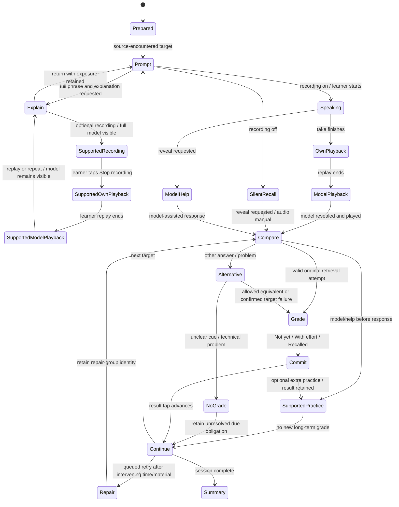

# Learning engine and review policy

Proposed implementation behaviour, 2026-10-11. Derived from the [agreed drills](../decision-targeted-drilling.md) and [research-based design](../design/answer-card-and-review-policy.md). Prototyping checks interaction clarity and software/device behaviour; it does not ask the learner to establish effective intervals.

**Current recommendation:** Not yet / With effort / Recalled and an FSRS-based policy with 0.90 default retention, automatic target-state updates and a separate repair queue. The active flow below incorporates it; the former fixed ladder is historical. User acceptance of exact labels/parameters is still pending. The user has explicitly rejected learner-run validation, in-app experiments and special assessment sessions; testing here means software/content/device checks by the implementer.

**P3 update, 2026-10-12:** the [core trainer decision](../decision-core-trainer.md) describes the implemented version under the user's delegation. It overrides historical separate recording modes, problem/alternative submenus, Practice again and Undo below. Capture is optional per attempt; original response/support, FSRS, repairs, cue history and prepared dialogue rehearsal are implemented. P4 follows the [online-only decision](../decision-online-only.md) and minimal temporary-server-error handling; actual-device and content/source acceptance remain separate work.

## Separate the learning target from its presentation

One `LearningTarget` represents a fixed expression or a selected word sense/construction. A `Realization` is one complete sentence or dialogue line using it. A `CueVariant` specifies which meaningful chunks of that realization remain visible/audible, its purpose and additional help layers. A dialogue turn points to the same target and realization.

For fixed phrases, preserve the requested wording and permitted equivalents. For a word/frame, identify the lexical/construction material to retrieve and the slots allowed to vary. Different examples are not separate scheduled cards. Different senses are different targets. Similar text from two sources is not automatically the same meaning.

## Cue eligibility and selection

Under the [external-agent decision](../decision-external-preparation-agent.md), the external agent prepares/checks useful masks before submission. Phrase Gym validates and persists the submitted set for later sessions. Session selection consumes this prepared set. Different hidden parts must not require a live LLM request during a drill.

1. Only published, reviewed cue variants are eligible. All chunk IDs must resolve within the pinned realization revision and reconstruct the original text exactly, including punctuation and spacing.
2. A cue must state the task, supply its use context and retain enough distinguishing language. Store plausible competing answers and why the chosen anchors distinguish the intended learned expression. This is a review aid, not a proof of universal uniqueness.
3. Do not generate a gap by removing the first N words, random positions or individual letters. The implementation renders authored chunk references.
4. Carry cue-presentation and hidden-chunk recall history across sessions. Among clear cues with comparable support, prefer one covering an under-practised or previously difficult chunk; use time since presentation and stable ordering as tie breakers. Avoid repeating the last version when a suitable complementary cue exists, but reuse one reliable cue if necessary. This selector is a design recommendation, not a research-derived difficulty formula; character count does not measure difficulty. Persistent coverage replaces the earlier requirement to retrieve every chunk at every interval level.
5. Full-model practice is always available as an explicit fallback. If there is no reliable retrieval cue, offer model practice and flag preparation work; do not manufacture an ambiguous test at runtime.
6. Record all exposed chunks, including audio and requested help. A lexical target that remained visible was used, not retrieved. Track recall coverage by required chunk; do not permanently label an entire phrase learned when the same part is always supplied.
7. During ordinary reviews, use different prepared situations or dialogue turns where appropriate to the same meaning/use. Fixed expressions retain their target wording; word/frame tasks may use reviewed realizations with allowed substitutions. Retain disambiguating anchors and comparable support; do not create random situations, mandatory zero-hint tests or additional schedules.

## Session behaviour

The interface can pause from any state. Persist the phase, current target/cue revision, help already used, media position where reliable, attempt identity and completed events. Resume an interrupted recording as interrupted; never invent a completed recording or a failed recall. Starting after viewing the full model is assisted practice until a later eligible attempt.

Commit a completed attempt to the local journal before advancing. On a connected client, submit it immediately and retain it until acknowledged. Do not block a spoken turn on generation, transcription or background media upload.

A new database item may already have been encountered in its source, so database novelty alone must not force an introduction. One session entry leads to the drill, with an explanation action available even before any response. That action reveals the full phrase and explanation in the learner's language; ordinary drill content remains in the target language. Opening help is not itself a failure grade. Record exposure and any explanation shown; returning to the cue or immediately repeating the model is assisted practice, not delayed independent recall. Follow the separated-retry rules below after help or failure. Persistent difficulty returns to meaning/cue repair rather than an endless repetition loop.

## Dialogues

- Introduce the complete short exchange first. The learner's target turns and supporting lines are identified explicitly.
- Play/show the partner's line; present a target-specific cue; ask for the complete response. Leave non-target lines available to read.
- A difficult turn can be isolated, repaired and reinserted at its original point. Keep the dialogue cursor and its target attempt history across that detour.
- Extra runs of a target in one dialogue are practice events on the same target. They cannot each advance its long-term interval.
- A dialogue introduced immediately before rehearsal counts as recent exposure. A later due session may provide an eligible observation; the planner records the difference.

## Outcome model

Store observations rather than a single ambiguous “correct” flag:

| Observation | Record | Scheduling meaning |
|---|---|---|
| Target reproduced with the planned partial cue | `target_matched`, planned visible/hidden chunks, self-report or assessment origin; With effort or Recalled | An eligible first observation maps to Hard/2 or Good/3 respectively; cued-retrieval evidence, not proof of independent speech. |
| Target word/frame is still shown | `controlled_use`, visible required material | Practice evidence only; does not advance lexical-recall progress. |
| Additional phrase material/full model used before responding | `extra_help` or `model_exposed` | Assisted attempt; later repair cannot erase that support. |
| Learner cannot retrieve a clearly specified target | `target_not_retrieved`, Not yet | An eligible first observation maps to Again/1, followed by repair. Hard is never a forgotten or partially recalled answer. |
| Different natural wording is offered | `alternative_response` | No automatic memory failure. Offer target practice or report unclear cue. |
| Cue is ambiguous | `cue_reported`, reason and cue revision | No grade; prevent that variant from being selected again for this learner until reviewed. |
| Audio, recording or recognition fails | `technical_failure` / `assessment_uncertain` | No grade; offer self-check or repeat the technical step. |
| Silent practice | `silent_practice`, actual support, original-attempt self-report | Proposed rule: deliberate retrieval before reveal can use the same memory ratings; reading/recognition cannot. It supplies no spoken-performance evidence. |
| Skipped or abandoned | `skipped` / incomplete session | No failure. Already committed attempts remain saved. |

Self-checking is the initial assessment method. A later ASR component can return evidence and uncertainty but cannot silently replace the learner's report or penalize a valid alternative. No speech recognizer is a dependency of the first useful trainer.

## Current adaptive policy recommendation

Implement a versioned `ReviewPolicy` adapter around a maintained, pinned FSRS library. Use population parameters and **0.90 desired retention** for the declared cued-retrieval task. Normal eligible ratings update the target's difficulty/stability and next due time using actual elapsed time. No learner tuning, calibration task or effectiveness experiment is part of this policy.

- Map **Not yet → Again/1**, **With effort → Hard/2**, **Recalled → Good/3**. Omit Easy from the initial interface. Grade the original response before feedback; Practice again is a separate action. Model help before any attempt is exposure, not an inferred failure.
- Keep one target schedule across cues, contexts, lessons and dialogue appearances. Persist coverage separately; incomplete coverage guides the next cue without a per-interval promotion gate.
- A newly imported item can begin with an ordinary retrieval attempt. After study without a valid retrieval grade, schedule a next-day learning check as a fallback, explicitly without inventing a successful grade.
- After failure, give model/meaning feedback, offer supported practice, then queue a retrieval retry roughly **5–10 minutes** later and after **at least two other targets** when feasible. Otherwise defer to a later session; never make the learner wait for a timer. These are chosen implementation defaults for applying spacing.
- Aim for one successful separated retry; allow at most **two extra retrieval attempts per target per session**. Persistent failure calls for meaning/cue repair and continuation later. Immediate model-visible takes remain optional practice, with every recording retained.
- Only the first eligible finalized observation in a review group updates the long-term state. Repairs preserve that first result and are logged separately. Disable library learning/relearning steps in this adapter so a second queue does not duplicate the app's repair loop.
- Let the library compute intervals and lapse adjustments from history. No universal one-day reset or permanent 30-day ceiling. Overdue items use their actual elapsed time; missed days do not reset a course.
- Search, explanation exposure, invalid cues, technical problems and skips do not fabricate successful or failed reviews. A no-grade event leaves the due obligation unresolved. Log support, optional extra practice and exposure even when they do not change due dates.

The full [answer-card policy](../design/answer-card-and-review-policy.md) defines assistance, silent recall and session-selection recommendations. The estimated retention applies to the recorded task; it is not a spoken-fluency percentage.

### Superseded proposal, for provenance only

The earlier unapproved recommendation used levels of 1/3/7/14/30 days, a one-day lapse reset, a 30-day ceiling, every-chunk coverage at each level and retries after two intervening targets regardless of elapsed time. It is withdrawn as the preferred design. Do not implement it or expose it as a learner-run comparison policy.

## One review update, regardless of repetitions or devices

The server gives a due target a `review_group_id` and the current schedule version in the session manifest. Use a unique database constraint for that learner/target/group. Its first finalized eligible attempt determines the schedule observation; later cue variants, repairs and dialogue repetitions in that group update practice/coverage evidence but cannot promote the interval again. Newly covered chunks can count toward the next eligible review; do not recompute the earlier interval upward within the same group.

Extra voluntary practice before a target is due is logged without repeated promotions. Two devices carrying the same schedule version cannot both advance it: the second observation is retained with a `stale_schedule` receipt. A different payload under a previously accepted event ID is a conflict, not a second review.

Offline reports retain both occurrence time and receipt time. Accept a claimed occurrence time only within the issued session's time bounds and configured clock-skew allowance; otherwise retain the report but use server receipt time and label the adjustment. Never reorder already applied schedule updates based on a late client clock.

## Meaningful verification cases

1. Two masks and one dialogue appearance create one target schedule and multiple practice events.
2. A full-model reveal survives reload and cannot become unaided success on resume.
3. Retrying a network request after the response was lost changes the schedule exactly once.
4. A second device or old content revision cannot overwrite a newer schedule.
5. A fixed phrase whose opening is always supplied cannot reach complete recall coverage.
6. A visible target word in a controlled-use exercise cannot earn lexical recall credit.
7. A valid alternative, unclear cue, refused microphone permission or uncertain ASR is not a failed memory test.
8. A repaired turn returns to the dialogue without skipping a supporting line or creating another scheduled card.

## Recording mode and evidence

Persist the session's requested recording mode and the actual response modality of each attempt. A mode change is an event; it must not relabel earlier practice. Track recording/playback failures independently of recall outcomes. No recording does not prove silence, and replaying a take does not prove correctness.

The agreed recording-on sequence is response → automatic own-take playback → model reveal/playback → self-check. Keep model help exposure before a response separate from post-response comparison. Rerecording during repair retains earlier difficulty and exposure. The current policy recommendation allows deliberate silent retrieval to update memory scheduling using the same outcome definitions, with modality retained; it never supplies spoken-performance credit.

On Show & explain, optional recording and the learner/model playback sequence operate with the complete phrase visible throughout. This is an accepted supported-practice path, not an answer-reveal bug. Persist full-model exposure before capture and retain each take under the same target/history. Keep any earlier drill attempt's evidence unchanged; a supported take cannot retroactively repair its grade or count as independent recall. Respect the existing session recording switch and never request a microphone merely to open the explanation card.
