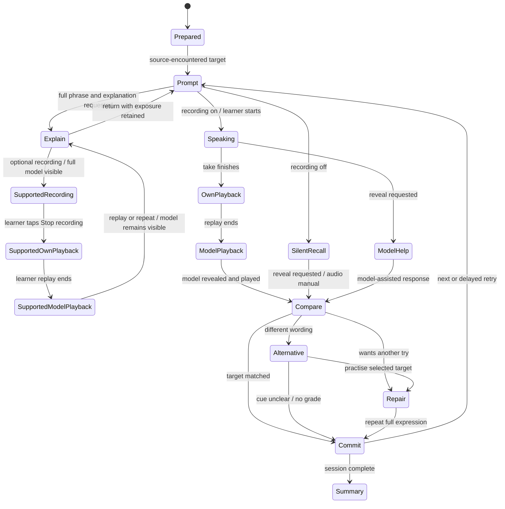

# Learning engine and review policy

Proposed implementation behaviour, 2026-10-11. Derived from the [agreed drills](../decision-targeted-drilling.md); the exact defaults below must be tested during [prototyping](../plan/01-prototyping.md). They are not new claims about research-proven learning intervals or cue difficulty.

**Latest recommendation:** the [research-based answer-card and review design](../design/answer-card-and-review-policy.md) recommends Not yet / With effort / Recalled and an FSRS-based policy with 0.90 default retention, automatic target-state updates and a separate repair queue. It supersedes the fixed ladder below as the assistant's preferred proposal. User acceptance of exact labels/parameters is still pending. The user has explicitly rejected learner-run validation, in-app experiments and special assessment sessions; testing here means software/content/device checks by the implementer.

## Separate the learning target from its presentation

One `LearningTarget` represents a fixed expression or a selected word sense/construction. A `Realization` is one complete sentence or dialogue line using it. A `CueVariant` specifies which meaningful chunks of that realization remain visible/audible, its purpose and additional help layers. A dialogue turn points to the same target and realization.

For fixed phrases, preserve the requested wording and permitted equivalents. For a word/frame, identify the lexical/construction material to retrieve and the slots allowed to vary. Different examples are not separate scheduled cards. Different senses are different targets. Similar text from two sources is not automatically the same meaning.

## Cue eligibility and selection

The accepted preparation timing is phrase intake: when adding a phrase to the database, have the LLM prepare useful alternate masks, check them and persist them for later sessions. Session selection consumes this prepared set. Different hidden parts must not require a live LLM request during a drill.

1. Only published, reviewed cue variants are eligible. All chunk IDs must resolve within the pinned realization revision and reconstruct the original text exactly, including punctuation and spacing.
2. A cue must state the task, supply its use context and retain enough distinguishing language. Store plausible competing answers and why the chosen anchors distinguish the intended learned expression. This is a review aid, not a proof of universal uniqueness.
3. Do not generate a gap by removing the first N words, random positions or individual letters. The implementation renders authored chunk references.
4. Carry cue-presentation history across sessions so the next session can choose a reviewed alternative that requires recall of a different meaningful chunk. The proposed selector uses deterministic rotation among eligible variants, avoiding the last shown version when suitable alternatives exist; a recently successful cue may be reused when support is still needed. If only one reliable cue exists, reuse it. Exact selection/adaptation rules remain to be validated; no difficulty ranking is inferred from character count.
5. Full-model practice is always available as an explicit fallback. If there is no reliable retrieval cue, offer model practice and flag preparation work; do not manufacture an ambiguous test at runtime.
6. Record all exposed chunks, including audio and requested help. A lexical target that remained visible was used, not retrieved. Track recall coverage by required chunk; do not permanently label an entire phrase learned when the same part is always supplied.

## Session behaviour

The interface can pause from any state. Persist the phase, current target/cue revision, help already used, media position where reliable, attempt identity and completed events. Resume an interrupted recording as interrupted; never invent a completed recording or a failed recall. Starting after viewing the full model is assisted practice until a later eligible attempt.

Commit a completed attempt to the local journal before advancing. On a connected client, submit it immediately and retain it until acknowledged. Do not block a spoken turn on generation, transcription or background media upload.

A new database item may already have been encountered in its source, so database novelty alone must not force an introduction. One session entry leads to the drill, with an explanation action available even before any response. That action reveals the full phrase and explanation in the learner's language; ordinary drill content remains in the target language. Opening help is not itself a failure grade. Record exposure and any explanation shown; returning to the cue or immediately repeating the model is assisted practice, not delayed independent recall. A tentative prototype session interleaves different targets before revisiting a target; exact session length and explanation-return behaviour remain to be reviewed.

## Dialogues

- Introduce the complete short exchange first. The learner's target turns and supporting lines are identified explicitly.
- Play/show the partner's line; present a target-specific cue; ask for the complete response. Leave non-target lines available to read.
- A difficult turn can be isolated, repaired and reinserted at its original point. Keep the dialogue cursor and its target attempt history across that detour.
- Extra runs of a target in one dialogue are practice events on the same target. They cannot each advance its long-term interval.
- A dialogue introduced immediately before rehearsal counts as recent exposure. A later due session may provide an eligible observation; the planner records the difference.

## Outcome model

Store observations rather than a single ambiguous “correct” flag:

| Observation | Record | Scheduling meaning |
|---|---|---|
| Target reproduced with the planned partial cue | `target_matched`, planned visible/hidden chunks, self-report or assessment origin | May qualify for the reviewed task, subject to the policy below; not proof of independent speech. |
| Target word/frame is still shown | `controlled_use`, visible required material | Practice evidence only; does not advance lexical-recall progress. |
| Additional phrase material/full model used before responding | `extra_help` or `model_exposed` | Assisted attempt; later repair cannot erase that support. |
| Learner cannot retrieve a clearly specified target | `target_not_retrieved` | An eligible recall difficulty, followed by repair. |
| Different natural wording is offered | `alternative_response` | No automatic memory failure. Offer target practice or report unclear cue. |
| Cue is ambiguous | `cue_reported`, reason and cue revision | No grade; prevent that variant from being selected again for this learner until reviewed. |
| Audio, recording or recognition fails | `technical_failure` / `assessment_uncertain` | No grade; offer self-check or repeat the technical step. |
| Silent practice | `silent_practice`, actual support, self-report if supplied | Not spoken-performance evidence; do not automatically apply a spoken-recall grade. Its exact review effect remains to be decided. |
| Skipped or abandoned | `skipped` / incomplete session | No failure. Already committed attempts remain saved. |

Self-checking is the initial assessment method. A later ASR component can return evidence and uncertainty but cannot silently replace the learner's report or penalize a valid alternative. No speech recognizer is a dependency of the first useful trainer.

## Earlier fixed-policy proposal — retained for provenance

Keep a `ReviewPolicy` interface from the beginning. The older recommendation was a small deterministic policy while considering FSRS later. After the user's research request, the [current recommendation](../design/answer-card-and-review-policy.md#scheduler-preferred-candidate) is FSRS with explicit recall grading and support classification. Neither policy was user-approved. The older defaults below are historical alternatives, not instructions to implement a 30-day cap, universal one-day lapse reset or per-level chunk-coverage gate. Do not offer a policy experiment to the learner.

Earlier defaults, preserved only to explain the change in recommendation:

- One schedule row per learner/target, with a policy version, target revision, interval level, next due time and concurrency version.
- Initial deliberate exposure schedules the first delayed review in one day; it is not a successful memory test.
- Start with configurable interval levels of **1, 3, 7, 14 and 30 days**, measured from the accepted review time. These are transparent engineering defaults, not claimed optimal intervals or a research result.
- An eligible successful due review advances at most one level. Keep the maximum level at 30 days until pilot evidence supports another configuration. A prompted observation is labelled as such throughout.
- For a fixed phrase, require a successful reviewed rotation to have demanded recall of every required chunk across the current level before advancing; a chunk always displayed does not count. Keep coverage as metadata on the one schedule, not as additional schedules.
- For a word/frame, the required lexical/construction material must actually have been hidden and retrieved. Showing the target and asking for a sentence is controlled-use practice only.
- Additional help or failure during an eligible due recall resets the proposed level to one-day review and queues a same-session repair. The learner can repeat successfully, but those immediate repetitions do not earn a longer interval.
- A successful but incomplete chunk-coverage review stays at its current level; choose a complementary cue at the next review. Invalid cues and technical failures leave the due obligation unresolved rather than downgrading the learner.
- Put a repair retry after two other targets when available, otherwise at the end. Cap retries at two per target per session; leave the next review visible rather than creating an endless loop. These are configurable UX defaults to validate in P1.

These rules may be simplified after the prototype if coverage tracking imposes unnecessary reviews; any change is versioned and documented. The architecture does not assume that an interval level measures spontaneous fluency.

## One review update, regardless of repetitions or devices

The server gives a due target a `review_group_id` and the current schedule version in the session manifest. Use a unique database constraint for that learner/target/group. Its first finalized eligible attempt determines the schedule observation; later cue variants, repairs and dialogue repetitions in that group update practice/coverage evidence but cannot promote the interval again. Newly covered chunks can count toward the next eligible review; do not recompute the earlier interval upward within the same group.

Extra voluntary practice before a target is due is logged without repeated promotions. Two devices carrying the same schedule version cannot both advance it: the second observation is retained with a `stale_schedule` receipt. A different payload under a previously accepted event ID is a conflict, not a second review.

Offline reports retain both occurrence time and receipt time. Accept a claimed occurrence time only within the issued session's time bounds and configured clock-skew allowance; otherwise retain the report but use server receipt time and label the adjustment. Never reorder already applied schedule updates based on a late client clock.

## Meaningful verification cases

1. Two masks and one dialogue appearance create one target schedule and multiple practice events.
2. A full-model reveal survives reload and cannot become unaided success on resume.
3. Retrying a network request after the response was lost changes the schedule exactly once.
4. A second device or old content revision cannot overwrite a newer schedule.
5. A fixed phrase whose opening is always supplied cannot reach complete recall coverage.
6. A visible target word in a controlled-use exercise cannot earn lexical recall credit.
7. A valid alternative, unclear cue, refused microphone permission or uncertain ASR is not a failed memory test.
8. A repaired turn returns to the dialogue without skipping a supporting line or creating another scheduled card.

## Recording mode and evidence

Persist the session's requested recording mode and the actual response modality of each attempt. A mode change is an event; it must not relabel earlier practice. Track recording/playback failures independently of recall outcomes. No recording does not prove silence, and replaying a take does not prove correctness.

The agreed recording-on sequence is response → automatic own-take playback → model reveal/playback → self-check. Keep model help exposure before a response separate from post-response comparison. Rerecording during repair retains earlier difficulty and exposure. Recording-off silent practice is useful practice but cannot silently receive spoken-recall credit. Resolve its schedule effect explicitly when the review policy is chosen; the proposed interval defaults above do not settle that question.

On Show & explain, optional recording and the learner/model playback sequence operate with the complete phrase visible throughout. This is an accepted supported-practice path, not an answer-reveal bug. Persist full-model exposure before capture and retain each take under the same target/history. Keep any earlier drill attempt's evidence unchanged; a supported take cannot retroactively repair its grade or count as independent recall. Respect the existing session recording switch and never request a microphone merely to open the explanation card.
